# Smart Grocery Management System
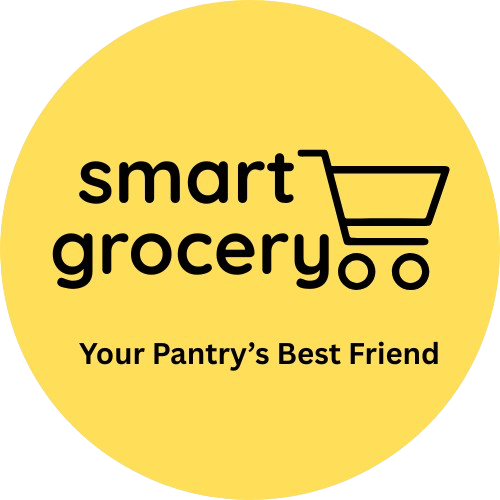

## The Problem
Food waste costs the average American household $1,500 annually. Many people struggle to track grocery expiration dates and miss important food safety recalls, leading to waste and potential health risks.

## Solution
The **Smart Grocery Management System** is a mobile app designed to help individuals and households manage their groceries efficiently, reduce food waste, and prioritize food safety. Users can track inventory, get expiration alerts, scan barcodes, and receive food recall notifications. This project was developed as part of the CISC.4900 course during the Spring 2025 semester, under the guidance of Allan James Lapid & Professor Katherine Chuang at CUNY-Brooklyn College.

## App Screenshots
### 🔐 Authentication
<p float="left">
  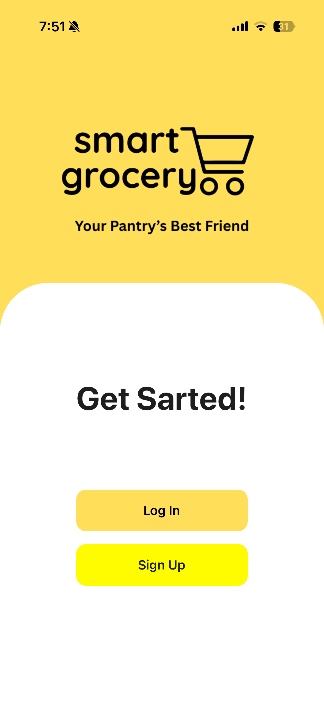
  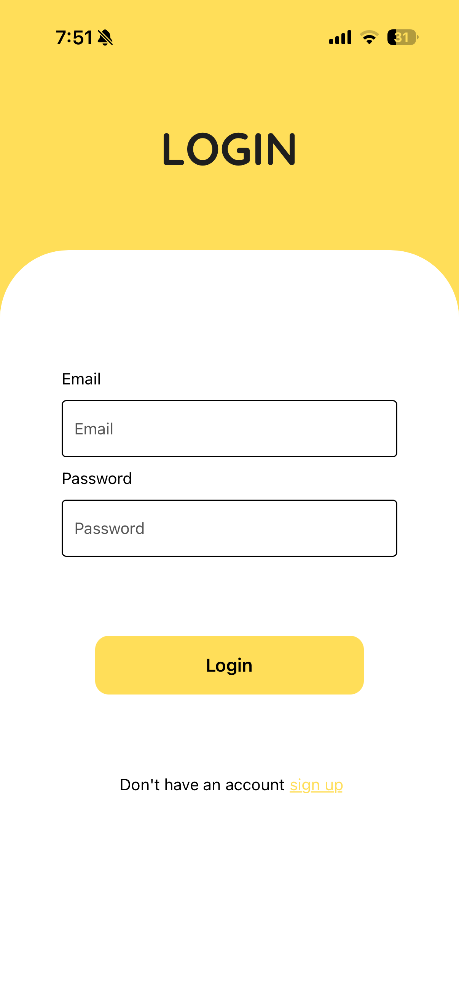
</p>

### 🏠 Dashboard
<p float="left">
  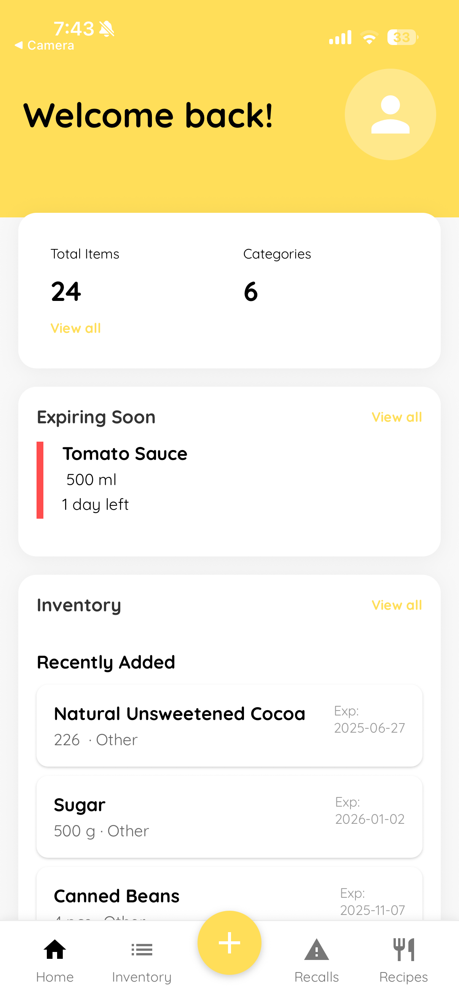
</p>

### 📋 Inventory Management
<p float="left">
  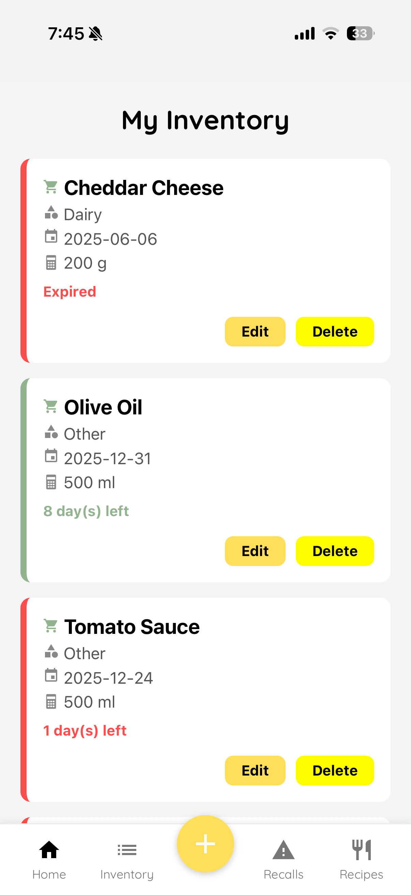
  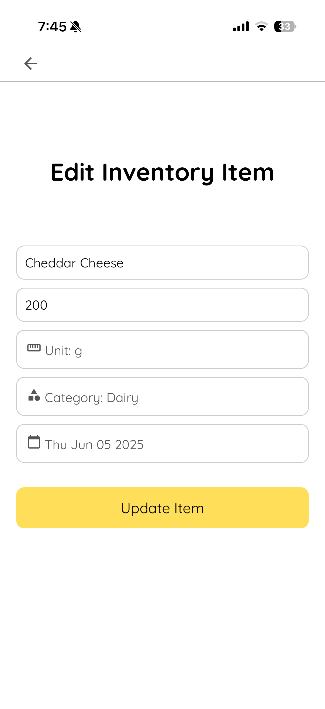
</p>

### 📷 Barcode Scanning
<p float="left">
  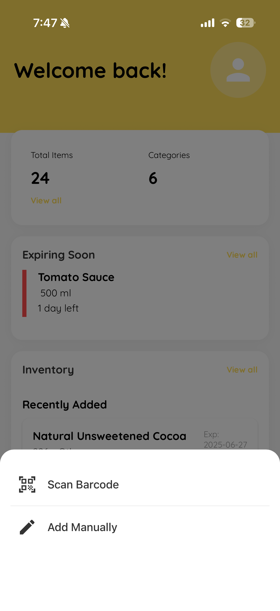
  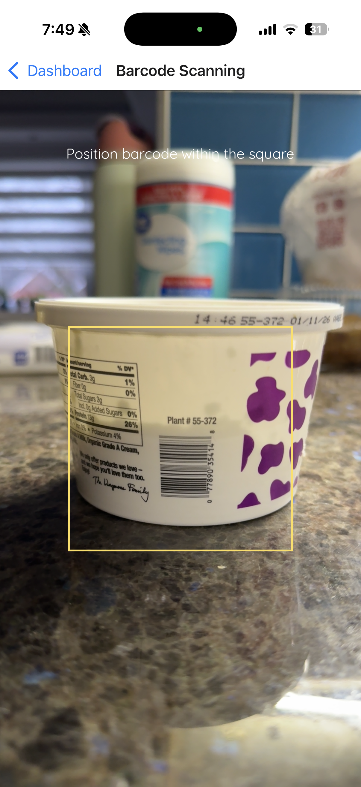
  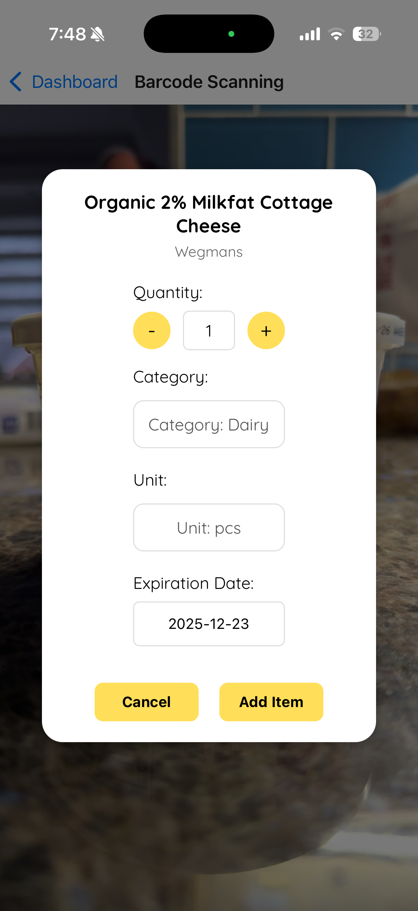
</p>

### 🔍 Food Recall Alerts
<p float="left">
  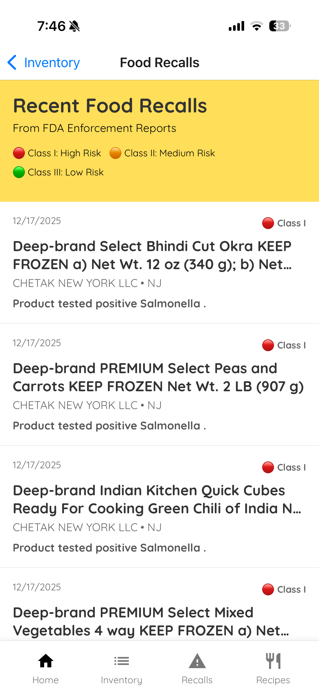
  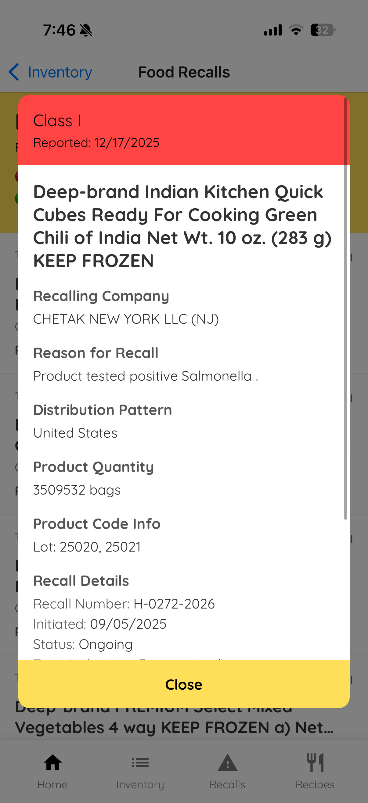
</p>

### 📝 Recipe Suggestions
<p float="left">
  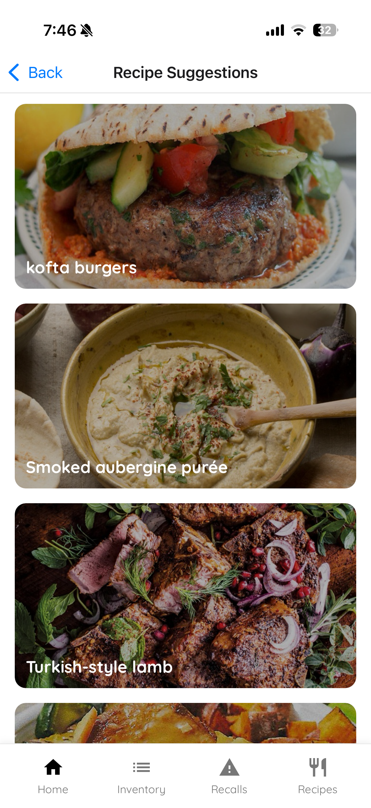
</p>

## 🚀 Features
* 📋 **Inventory Management** - Add, edit, and delete grocery items with ease
* 🔐 **User Authentication** - Secure sign-up and login with user-specific data access
* ⏰ **Expiration Tracking & Notifications** - Receive notifications before items expire
* 📷 **Barcode Scanning** - Quickly add items by scanning their barcodes
* 🔍 **Food Recall Alerts** - Stay informed about recalled products
* 📝 **Recipe Suggestions** - Get meal ideas based on your inventory

## 🛠️ Tech Stack
* **Frontend:** React Native (with Expo)
* **Backend:** Firebase (Firestore, Authentication, Cloud Messaging)
* **APIs**:
   * **Open Food Facts** – for barcode scanning and product data
   * **TheMealDB** – for recipe suggestions
   * **FDA/USDA APIs** – for food recall alerts
* **Version Control:** GitHub
* **Design:** Figma

## 🧠 Key Technical Implementations
- **Real-time notifications** using Firebase Cloud Messaging for expiration alerts
- **Barcode scanning integration** with camera API and Open Food Facts database
- **Multi-API integration** managing data from FDA, USDA, and recipe databases
- **Firebase Authentication** for secure user account management
- **Firestore database** for real-time inventory synchronization

## 👩‍💻 Developers
This project was developed by Sena Orucu & Zarina Shevchenko.
* **📧 Sena Orucu:** orucusena21@gmail.com
* **📧 Zarina Shevchenko:** zarinashevchenko@gmail.com

## 🚀 Setup Instructions

### Prerequisites
- Node.js installed
- Expo CLI installed globally
- iOS Simulator or Android Emulator (optional)

### Installation

1. Clone the repository
```bash
git clone [your-repo-url]
cd smart-grocery-management-system
```
2. Install dependencies
```bash
npm install
```
3. Start the app
```bash
npx expo start
```
You can then run the app using:
- iOS Simulator
- Android Emulator
- Expo Go (limited sandbox)


### 🔧 Configuration
- Create a Firebase project
- Enable Firestore and Authentication
- Add Firebase configuration to the project
- Configure API access for:
    * Open Food Facts
    * TheMealDB
    * FDA/USDA APIs

>⚠️ API keys and secrets are not included in this repository


### 🤝 Contributing
This project was developed as a capstone project. While not actively maintained, feel free to explore the code and adapt it for your own use.

## 📌 Project Status
Completed as a senior capstone project (Spring 2025).


